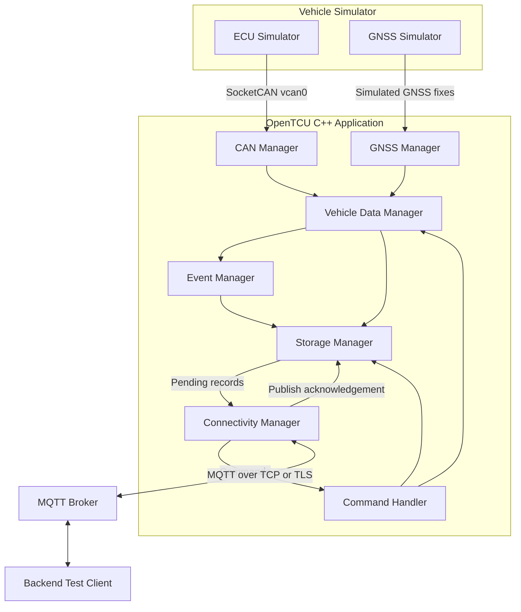

# OpenTCU — Linux Vehicle Telematics Gateway

A C++11/Linux proof of concept (POC) for a Telematics Control Unit (TCU) that collects vehicle signals, maintains vehicle state, generates events and communicates with a backend over MQTT.

**Project status:** In development — high-level design completed; implementation pending.

## Overview

OpenTCU explores the application-layer architecture of an automotive telematics gateway using simulated vehicle hardware. It is designed to run on a Linux development machine without a physical CAN controller, GNSS receiver or cellular modem.

The project focuses on embedded Linux networking, asynchronous C++ software architecture, inter-thread communication, resilient connectivity and reliable telemetry delivery.

## Planned capabilities

- Acquire and decode simulated vehicle CAN frames using Linux SocketCAN (`vcan0`).
- Process vehicle speed, engine RPM, temperature, fuel level and ignition state.
- Integrate simulated GNSS location and validity information.
- Publish periodic vehicle telemetry and event alerts over MQTT.
- Handle remote status requests and telemetry configuration commands.
- Store outbound messages locally using a persistent SQLite outbox.
- Recover from network outages using reconnection, backoff and message replay.
- Support graceful shutdown, structured logging and automated testing.

## High-level architecture



## Design approach

The TCU is planned as a modular, multithreaded C++11 application with a separate vehicle simulator and MQTT broker. A single state-owner worker processes vehicle signals and produces consistent snapshots. Dedicated storage and connectivity workers isolate database and network I/O from vehicle data acquisition.

The implementation will use the Eclipse Paho MQTT C asynchronous API through a C++11 RAII wrapper, keeping the MQTT transport independent of the vehicle application logic. Components will use C++11-compatible standard library features and dependencies.

Telemetry, events and command results will be persisted before publication. MQTT QoS 1 acknowledgements will be used to track delivery to the broker, while stable application-level message IDs will allow duplicate detection after retries or restarts.

## Technology stack

| Area | Planned technology |
| --- | --- |
| Language | C++11 |
| Platform | Linux / Ubuntu / WSL2 |
| Vehicle communication | SocketCAN, virtual CAN (`vcan`), can-utils |
| Cloud connectivity | MQTT, Eclipse Paho MQTT C (`MQTTAsync`), C++11 wrapper, Mosquitto |
| Data exchange | JSON |
| Local persistence | SQLite |
| Concurrency | `std::thread`, mutex, condition variable, bounded queues |
| Build and testing | CMake, C++11-compatible GoogleTest release |

The build will enforce the C++11 standard without compiler-specific language extensions.

```cmake
set(CMAKE_CXX_STANDARD 11)
set(CMAKE_CXX_STANDARD_REQUIRED ON)
set(CMAKE_CXX_EXTENSIONS OFF)
```

## Development roadmap

- [x] Define scope and high-level architecture.
- [ ] Define detailed C++ component interfaces and thread design.
- [ ] M1 — Implement the ECU simulator and SocketCAN receiver.
- [ ] M2 — Implement vehicle state, GNSS simulation and event detection.
- [ ] M3 — Implement MQTT telemetry and remote commands.
- [ ] M4 — Implement persistent outbox, reconnection and fault recovery.
- [ ] M5 — Add integration tests, documentation and a repeatable end-to-end demo.

## Documentation

The High Level Design (HLD) describes the component architecture, signal mapping, message contracts, thread ownership, connectivity state machine, persistence strategy and acceptance criteria. It will be maintained in the `docs/` directory as implementation progresses.

## Getting started

The repository is currently at the design stage. Build, dependency installation and execution instructions will be added with the first working implementation. Linux SocketCAN virtual CAN support must be available for CAN-based integration tests; a mock source is planned for environments without `vcan` support.

## Scope and limitations

OpenTCU uses synthetic vehicle signals and simulated location data. It is intended for engineering learning and experimentation, not production automotive deployment or safety-critical vehicle control. Real modem integration, UDS diagnostics, OTA updates and power management are future extensions.

## Author

Dipankar Barman — [GitHub profile](https://github.com/deepbipul)
